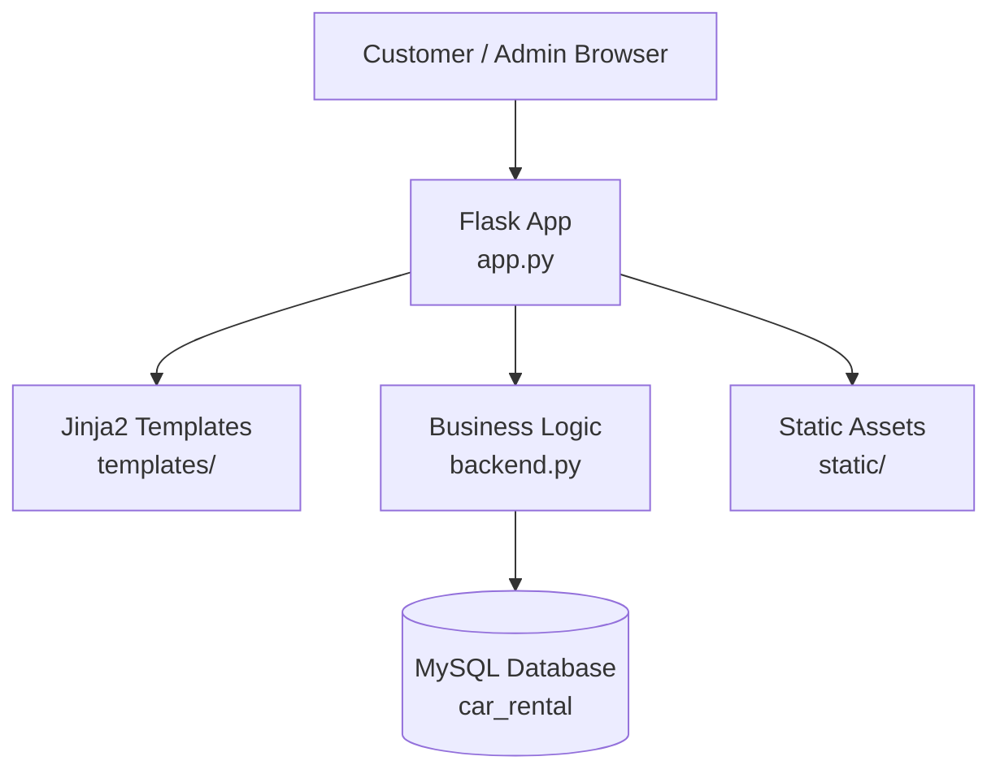
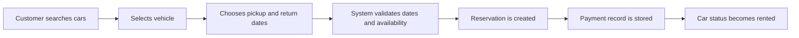

<div align="center">

# 🚗 CarRental: Full-Stack Car Rental System

**A Flask and MySQL web application for browsing cars, managing reservations, tracking payments, and generating operational rental reports.**

[](https://www.python.org/)
[](https://flask.palletsprojects.com/)
[](https://www.mysql.com/)
[](https://getbootstrap.com/)
[](https://pypi.org/project/bcrypt/)

### 🚀 Live Application

[](https://youssefmohattia.pythonanywhere.com/)

**[Launch CarRental](https://youssefmohattia.pythonanywhere.com/)**

</div>

---

## Table of Contents

- [Overview](#overview)
- [Key Features](#key-features)
- [System Architecture](#system-architecture)
- [Database Design](#database-design)
- [Tech Stack](#tech-stack)
- [Project Structure](#project-structure)
- [Getting Started](#getting-started)
- [Deployment](#deployment)
- [Application Routes](#application-routes)
- [Testing](#testing)
- [Roadmap](#roadmap)

---

## Overview

**CarRental** is a full-stack web application for car rental operations. Customers can register, log in, search available cars, create reservations, view booking history, and cancel active reservations. Administrators can log in, add new vehicles, monitor fleet statistics, and generate business reports for reservations, car status, payments, revenue, and office performance.

The system is built with a simple layered structure:

- **Flask routes** in `app.py` handle web requests, sessions, forms, and templates.
- **Business logic and database access** in `backend.py` manage customers, admins, cars, reservations, payments, and reports.
- **MySQL schema and seed data** are provided through `schema.sql` and `DML.sql`.
- **Bootstrap templates** provide responsive customer and admin dashboards.

**Live application:** [youssefmohattia.pythonanywhere.com](https://youssefmohattia.pythonanywhere.com/)

---

## Key Features

### Customer Experience

- Account registration with email, password, and phone validation
- Secure customer password hashing with `bcrypt`
- Customer login and session-based access control
- Search available cars by model, year, and maximum daily price
- Reserve cars for future pickup and return dates
- Automatic reservation price calculation from rental duration and daily rate
- Automatic payment record creation when a reservation is made
- Customer dashboard with reservation history and cancellation actions

### Admin Experience

- Admin login and protected dashboard
- Fleet statistics for total, active, and rented cars
- Add new cars with model, year, office, plate ID, and daily price
- Date-range reports for reservations and payments
- Filter reservations by car plate ID or customer SSN
- View car availability/status across a selected period
- Revenue reporting by car
- Office-level statistics for fleet size, reservations, and revenue

### Data and Business Rules

- Reservation date validation prevents invalid pickup/return ranges
- Availability checks prevent active overlapping reservations
- Car status updates when reservations are created, cancelled, picked up, or returned
- Late return logic supports extra charge calculation
- Payments are linked to reservations for revenue reporting

---

## System Architecture



### Main Flow



---

## Database Design

The database is named `car_rental` and includes six main tables:

| Table | Purpose |
|---|---|
| `offices` | Rental office locations and contact numbers |
| `cars` | Fleet vehicles, status, office assignment, and daily pricing |
| `customers` | Customer accounts and contact details |
| `admin` | Admin accounts used for dashboard access |
| `reservations` | Booking lifecycle, dates, pricing, and status |
| `payments` | Payment records connected to reservations |

Core relationships:

- One office can manage many cars.
- One customer can create many reservations.
- One car can appear in many reservations over time.
- One reservation can have payment records.

<p align="center">
  
</p>

The repository also includes an additional ERD export in `erd.jpg`.

---

## Tech Stack

| Layer | Technologies |
|---|---|
| Backend | Python, Flask |
| Database | MySQL, `mysql-connector-python` |
| Authentication | Flask sessions, `bcrypt` for customer passwords |
| Frontend | HTML, CSS, Bootstrap, Jinja2 templates |
| Styling and Icons | Bootstrap, Font Awesome |
| Testing / Smoke Checks | Python test script in `test_backend.py` |
| Hosting | PythonAnywhere |

---

## Project Structure

```text
Full-Stack-Car-Rental-System/
|-- app.py                  # Flask routes, sessions, forms, and page rendering
|-- backend.py              # Database connection, business logic, reports
|-- schema.sql              # MySQL database and table definitions
|-- DML.sql                 # Sample seed data for offices, cars, users, reservations
|-- test_backend.py         # Manual backend operation checks
|-- erd.jpg                 # Entity relationship diagram
|-- image.png               # Project image/screenshot asset
|-- Report.pdf              # Project report
|-- static/
|   |-- css/style.css
|   `-- images/             # Car and UI images
`-- templates/
    |-- base.html
    |-- index.html
    |-- admin/
    |   |-- login.html
    |   |-- dashboard.html
    |   |-- add_car.html
    |   `-- reports.html
    `-- customer/
        |-- register.html
        |-- login.html
        |-- search.html
        |-- reserve.html
        `-- dashboard.html
```

---

## Getting Started

### Prerequisites

- Python 3.8 or newer
- MySQL Server
- `pip`

### 1. Clone the repository

```bash
git clone https://github.com/YoussefMohAttia/Full-Stack-Car-Rental-System.git
cd Full-Stack-Car-Rental-System
```

### 2. Create and activate a virtual environment

```bash
python -m venv venv

# Windows
venv\Scripts\activate

# macOS / Linux
source venv/bin/activate
```

### 3. Install dependencies

```bash
pip install flask mysql-connector-python bcrypt
```

### 4. Create the MySQL database

Log in to MySQL and run the schema file:

```bash
mysql -u root -p < schema.sql
```

To add sample offices, cars, customers, admins, reservations, and payments:

```bash
mysql -u root -p car_rental < DML.sql
```

### 5. Configure the database connection

Update the connection settings in `backend.py` if your MySQL username or password is different:

```python
self.db = mysql.connector.connect(
    host="localhost",
    user="root",
    password="",
    database="car_rental"
)
```

> For non-local deployments, use secure credentials and keep passwords out of the repository.

### 6. Run the application

```bash
python app.py
```

Open the app in your browser:

```text
http://127.0.0.1:5000
```

### Sample Admin Credentials (Local Seed Data)

If you load `DML.sql`, the provided local sample accounts are:

| Email | Password |
|---|---|
| `admin@example.com` | `adminpass123` |
| `super@example.com` | `superpass456` |

> These are example credentials from the local seed data, **not verified credentials for the live website**. Do not use these passwords for production accounts.

---

## Deployment

The application is hosted on **PythonAnywhere** and can be accessed through its public web address:

**🌐 [Open the Live CarRental Application](https://youssefmohattia.pythonanywhere.com/)**

---

## Application Routes

| Route | Method | Description |
|---|---|---|
| `/` | GET | Landing page and fleet overview |
| `/customer/register` | GET / POST | Customer registration |
| `/customer/login` | GET / POST | Customer login |
| `/customer/logout` | GET | Customer logout |
| `/customer/search` | GET | Search available cars |
| `/customer/reserve/<plate_id>` | GET / POST | Create a reservation for a car |
| `/customer/dashboard` | GET | Customer reservations dashboard |
| `/customer/reservation/cancel/<reservation_id>` | GET | Cancel an active reservation |
| `/admin/login` | GET / POST | Admin login |
| `/admin/logout` | GET | Admin logout |
| `/admin/dashboard` | GET | Admin statistics dashboard |
| `/admin/cars/add` | GET / POST | Add a new car |
| `/admin/reports` | GET | Reservation, payment, revenue, and office reports |

---

## Testing

The repository includes `test_backend.py`, which performs manual smoke checks for:

- Creating test office data
- Registering a car as an admin
- Fetching fleet statistics
- Registering a customer
- Searching available cars
- Creating a reservation
- Reading reservation, status, and payment reports

Run it with:

```bash
python test_backend.py
```

> Note: The test script expects a local MySQL database named `car_rental` with the same credentials configured in `backend.py`.

---

## Roadmap

Potential future improvements:

- Online payment gateway integration
- Booking confirmation and reminder emails
- Expanded filtering and sorting for available cars
- Improved reporting dashboards and analytics
- Automated unit and integration test coverage

---

<div align="center">

**Built as a full-stack database-driven car rental management project.**

**[🚗 Try the Live Application](https://youssefmohattia.pythonanywhere.com/)**

</div>
